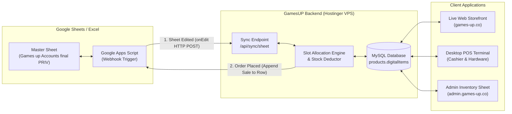

# GamesUP Accounts Inventory & Synchronization Architecture Report
**File Analyzed**: `Games up Accounts final PRIV.xlsx`  
**Date**: October 17, 2026  
**System Target**: GamesUP Web Storefront (`games-up.co`), Admin Dashboard (`admin.games-up.co`), and GamesUP Desktop POS Terminal

---

## 1. Executive Summary

An in-depth analysis of the master accounts spreadsheet (`Games up Accounts final PRIV.xlsx`) reveals a massive, multi-tiered digital game account infrastructure powering the GamesUP ecosystem.

### Key Inventory Metrics
| Metric | Count | Description |
| :--- | :---: | :--- |
| **Total Sheets (Product Categories)** | **17** | Separated by franchise, release year, or game tier |
| **Total Rows Processed** | **12,382** | Total lines across all spreadsheet tabs |
| **Active PlayStation Accounts** | **3,609** | Distinct accounts with valid login credentials |
| **Occupied / Sold Slots** | **12,958** | Slots actively allocated to paying customers |
| **Available / In-Stock Slots** | **10,196** | Unallocated slots ready for immediate sale |
| **Total Slot Capacity** | **23,154** | Full potential customer capacity across all accounts |

---

## 2. Category & Sheet Breakdown

The inventory is divided into 17 distinct operational sheets. Each sheet follows a structured slot model tailored to PlayStation 4 and PlayStation 5 licensing:

| # | Sheet Name | Total Rows | Valid Accounts | Sold Slots | In-Stock Slots | Primary Games & Editions |
| :-: | :--- | :---: | :---: | :---: | :---: | :--- |
| 1 | **FC27** | 1,182 | 260 | 842 | 458 | EA Sports FC 27 Pre-orders & Future Accounts |
| 2 | **Gta 6** | 1,019 | 29 | 38 | 22 | Grand Theft Auto VI Next-Gen Allocations |
| 3 | **PS PLUS 1yr3m extra** | 1,512 | 890 | 2,508 | 2,831 | PS Plus Deluxe, Extra & Essential (1 Year & 3 Months) |
| 4 | **NEW Relases** | 872 | 168 | 454 | 689 | Latest AAA Titles & Pre-Orders |
| 5 | **FC26** | 803 | 602 | 2,737 | 2,079 | EA Sports FC 26 (Standard & Ultimate editions) |
| 6 | **Gta VRD2** | 253 | 205 | 865 | 727 | Grand Theft Auto V & Red Dead Redemption 2 |
| 7 | **Story NBA R6 MK Cyberpunk W.D** | 1,111 | 183 | 677 | 752 | Cyberpunk 2077, NBA 2K, Mortal Kombat, Rainbow Six |
| 8 | **Crash Takes 2 Minecraft Gang b** | 1,119 | 204 | 786 | 844 | Co-op & Family Titles (It Takes Two, Minecraft, Crash) |
| 9 | **Call of duty all editions** | 219 | 127 | 526 | 488 | Call of Duty Franchise (Modern Warfare, Warzone, Cold War) |
| 10 | **Spider-Man All editions** | 976 | 56 | 194 | 188 | Marvel's Spider-Man 1, Miles Morales & Spider-Man 2 |
| 11 | **BO6** | 135 | 55 | 225 | 50 | Call of Duty: Black Ops 6 Dedicated Stock |
| 12 | **FC24** | 127 | 59 | 285 | 10 | EA Sports FC 24 Legacy Accounts |
| 13 | **Forza & NFS & Racing** | 140 | 77 | 270 | 285 | Need For Speed Unbound, Heat & Racing Games |
| 14 | **Wwe2K&UFC 5** | 107 | 33 | 126 | 134 | WWE 2K24 & UFC 5 Combat Titles |
| 15 | **ps plus (Legacy)** | 1,000 | 107 | 316 | 5 | Legacy PlayStation Plus Accounts |
| 16 | **GAMES (General)** | 865 | 208 | 775 | 238 | Multi-game Library Accounts & Variety Bundles |
| 17 | **FC25** | 942 | 346 | 1,334 | 396 | EA Sports FC 25 (Arabic & English editions) |
| **-** | **Total Summary** | **12,382** | **3,609** | **12,958** | **10,196** | **23,154 Total Capacity** |

---

## 3. Account & Slot Taxonomy

Every PlayStation Network account in this spreadsheet operates as a multi-license container divided into **5 distinct commercial slots**:

```
                         ┌───────────────────────────────────────────────┐
                         │       PlayStation Network Master Account      │
                         │ (Email, Password, First Mail, DOB, Region)    │
                         └───────────────────────┬───────────────────────┘
                                                 │
          ┌──────────────────────┬───────────────┴───────────────┬──────────────────────┐
          ▼                      ▼                               ▼                      ▼
┌───────────────────┐  ┌───────────────────┐           ┌───────────────────┐  ┌───────────────────┐
│ Primary PS4 (ON)  │  │ Primary PS5 (ON)  │           │   Secondary (ON)  │  │   Full Account    │
│ Activates Primary │  │ Activates Primary │           │ Plays via Master  │  │ Transferred with  │
│ on PS4 console    │  │ on PS5 console    │           │ User Profile Only │  │ Recovery Mail     │
└───────────────────┘  └───────────────────┘           └───────────────────┘  └───────────────────┘
          │                      │
          ▼                      ▼
┌───────────────────┐  ┌───────────────────┐
│ Primary PS4 (OFF) │  │ Primary PS5 (OFF) │
│ Offline play only │  │ Offline play only │
│ (No network sync) │  │ (No network sync) │
└───────────────────┘  └───────────────────┘
```

### Slot Definitions & Cell Representations in Spreadsheet:
1. **Primary PS4 (Online)**:
   - *In-Stock Indicator*: Empty cell, `-`, or `(-)`
   - *Sold Indicator*: Customer Name & Phone or Price (e.g., `Ahmed Frag (600)`)
   - *Unavailable Indicator*: `❌️❌️❌️` (When the game is PS5-exclusive)
2. **Primary PS5 (Online)**:
   - Primary license on PlayStation 5.
3. **Secondary (Online)**:
   - Played directly on the account profile with internet connection.
4. **Primary PS4 (OFF)**:
   - Offline primary console slot.
5. **Primary PS5 (OFF)**:
   - Offline primary console slot.
6. **Account Credentials & Metadata**:
   - `Email / Account`: PSN sign-in ID
   - `Password`: Current PSN password
   - `First mail / Sign id address`: Original creation email
   - `Gmail/outlook pass`: Recovery email password
   - `Birth date/Secuirty question`: Security details for account recovery
   - `Region`: Store currency and regional license (US, UK, TR, etc.)
   - `Account Price / Profit`: Financial acquisition cost and gross margin

---

## 4. Synchronization & Integration Architecture

To keep this spreadsheet fully editable while synchronizing stock and orders in real-time with the live website (`games-up.co`) and POS terminal, we implement a **Bidirectional Cloud Sync Engine**.



---

## 5. Bidirectional Workflow Details

### Workflow A: Automated Order Fulfillment (Storefront & POS -> Sheet)
1. **Purchase Event**: A customer places an order on `games-up.co` or the Cashier completes a sale on the POS Terminal for e.g. `FC 26 Primary PS5`.
2. **Atomic Slot Allocation**:
   - The backend searches `products.digitalItems` for the matching game.
   - Finds the first account where `slots['Primary PS5'].status === 'available'`.
   - Locks the slot and marks it `sold` with `order_id`, `customer_name`, and `customer_phone`.
3. **Webhook to Google Sheet**:
   - Backend calls the Google Apps Script Webhook:
     ```json
     {
       "action": "ORDER_ALLOCATED",
       "sheet": "FC26",
       "accountEmail": "fffup2525@outlook.com",
       "slotName": "Primary PS5",
       "customerData": "Mohamed Ali (01012345678) [Order #ORD-1092]"
     }
     ```
   - The script updates the corresponding cell in the Google Sheet in real-time.
4. **Instant Stock Sync**: The live product stock decreases by 1 immediately across web and desktop POS.

---

### Workflow B: Merchant Edits Sheet (Sheet -> Live Website & DB)
1. **Direct Edit**: The merchant opens Google Sheets on mobile or PC, adds 10 new accounts or edits a password.
2. **Apps Script Trigger (`onEdit`)**:
   - Automatically detects changes in account rows.
   - Posts the row payload to `https://admin.games-up.co/api/sync/sheet/update-row`.
3. **Database Upsert**:
   - The server verifies the `x-sheet-sync-token` security header.
   - Encrypts sensitive credentials via `server/utils/crypto.js`.
   - Merges the updated credentials into `products.digitalItems` in MySQL.
4. **Live Cache Refresh**: Storefront and POS immediately reflect the new stock without requiring a server reboot.

---

### Workflow C: In-Admin Native Grid (`InventorySheet.tsx`)
The repository already contains the frontend component for this:
- **Location**: `src/admin/pages/InventorySheet.tsx`
- **Features**:
  - Live table rendering all 5 slot columns (`Primary ps4`, `Primary ps5`, `Secondary`, `Offline ps4`, `Offline ps5`).
  - Inline editing with immediate debounce auto-save.
  - Multi-row bulk Excel/CSV import and export.
  - Real-time stock counts matching live orders.

---

## 6. Implementation Blueprint

### Step 1: Google Apps Script Webhook (For the Google Sheet)
Attach this script to `Extensions > Apps Script` inside the Google Sheet:

```javascript
const BACKEND_WEBHOOK_URL = "https://admin.games-up.co/api/sync/sheet";
const SYNC_SECRET_KEY = "GAMESUP_SECURE_SYNC_TOKEN_2026";

function onEdit(e) {
  const range = e.range;
  const sheet = range.getSheet();
  const sheetName = sheet.getName();
  const row = range.getRow();
  
  if (row < 2) return; // Ignore headers
  
  const rowValues = sheet.getRange(row, 1, 1, 15).getValues()[0];
  const email = rowValues[0];
  if (!email || !email.toString().includes('@')) return;

  const payload = {
    action: "ROW_EDITED",
    sheetName: sheetName,
    rowIndex: row,
    email: email.toString().trim(),
    password: rowValues[1] ? rowValues[1].toString().trim() : "",
    primaryPS4: rowValues[2] ? rowValues[2].toString().trim() : "",
    primaryPS5: rowValues[3] ? rowValues[3].toString().trim() : "",
    secondary: rowValues[4] ? rowValues[4].toString().trim() : "",
    primaryPS4Off: rowValues[5] ? rowValues[5].toString().trim() : "",
    primaryPS5Off: rowValues[6] ? rowValues[6].toString().trim() : "",
    type: rowValues[7] ? rowValues[7].toString().trim() : "",
    birthDate: rowValues[8] ? rowValues[8].toString().trim() : "",
    mailPass: rowValues[9] ? rowValues[9].toString().trim() : "",
    timestamp: new Date().toISOString()
  };

  UrlFetchApp.fetch(BACKEND_WEBHOOK_URL, {
    method: "post",
    contentType: "application/json",
    headers: { "x-sheet-sync-token": SYNC_SECRET_KEY },
    payload: JSON.stringify(payload),
    muteHttpExceptions: true
  });
}

function doPost(e) {
  // Handles incoming callbacks from GamesUP to update slot cells when an order is placed
  try {
    const data = JSON.parse(e.postData.contents);
    const ss = SpreadsheetApp.getActiveSpreadsheet();
    const sheet = ss.getSheetByName(data.sheetName);
    if (!sheet) return ContentService.createTextOutput("Sheet not found");

    const emails = sheet.getRange("A:A").getValues();
    let targetRow = -1;
    for (let i = 0; i < emails.length; i++) {
      if (emails[i][0] && emails[i][0].toString().toLowerCase() === data.email.toLowerCase()) {
        targetRow = i + 1;
        break;
      }
    }

    if (targetRow !== -1 && data.columnIndex) {
      sheet.getRange(targetRow, data.columnIndex).setValue(data.allocatedValue);
      return ContentService.createTextOutput(JSON.stringify({ success: true, row: targetRow }));
    }
    return ContentService.createTextOutput(JSON.stringify({ success: false, error: "Row not found" }));
  } catch (err) {
    return ContentService.createTextOutput(JSON.stringify({ success: false, error: err.message }));
  }
}
```

### Step 2: Backend Sync Route (`server/routes/sheetSyncRoutes.js`)
Handles secure incoming notifications from the sheet and broadcasts slot changes to connected POS terminals and web cache:

```javascript
import express from 'express';
import pool from '../db/connection.js';

export const sheetSyncRoutes = express.Router();

sheetSyncRoutes.post('/sync/sheet', async (req, res) => {
  const token = req.headers['x-sheet-sync-token'];
  if (token !== process.env.SHEET_SYNC_SECRET) {
    return res.status(401).json({ success: false, error: 'Unauthorized sync request' });
  }

  const { sheetName, email, password, primaryPS4, primaryPS5, secondary, primaryPS4Off, primaryPS5Off, type } = req.body;
  if (!email) return res.status(400).json({ success: false, error: 'Email is required' });

  try {
    // 1. Identify matching product from sheet name or game type
    const [products] = await pool.query(
      `SELECT id, name, digitalItems, stock FROM products 
       WHERE LOWER(name) LIKE ? OR JSON_SEARCH(digitalItems, 'one', ?) IS NOT NULL LIMIT 1`,
      [`%${sheetName}%`, email]
    );

    if (products.length > 0) {
      const prod = products[0];
      let items = typeof prod.digitalItems === 'string' ? JSON.parse(prod.digitalItems) : (prod.digitalItems || []);
      
      let item = items.find(it => it.email && it.email.toLowerCase() === email.toLowerCase());
      if (!item) {
        item = { email, password, slots: {} };
        items.push(item);
      } else {
        item.password = password || item.password;
      }

      // Update slot allocation states
      item.slots = item.slots || {};
      const updateSlot = (slotKey, cellVal) => {
        const val = String(cellVal || '').trim();
        const isSold = val !== '' && val !== '-' && val !== '(-)' && !val.includes('❌');
        item.slots[slotKey] = {
          status: isSold ? 'sold' : 'available',
          soldTo: isSold ? val : null,
          code: item.slots[slotKey]?.code || ''
        };
      };

      updateSlot('Primary ps4', primaryPS4);
      updateSlot('Primary ps5', primaryPS5);
      updateSlot('Secondary', secondary);
      updateSlot('Offline ps4', primaryPS4Off);
      updateSlot('Offline ps5', primaryPS5Off);

      // Recalculate available stock count
      let availableCount = 0;
      items.forEach(it => {
        if (it.slots) {
          Object.values(it.slots).forEach(s => {
            if (s && s.status === 'available') availableCount++;
          });
        }
      });

      await pool.query(
        'UPDATE products SET digitalItems = ?, stock = ? WHERE id = ?',
        [JSON.stringify(items), availableCount, prod.id]
      );

      return res.json({ success: true, updatedProductId: prod.id, stock: availableCount });
    }

    return res.json({ success: true, message: 'Received, no matching product bound yet' });
  } catch (err) {
    console.error('Sheet sync error:', err);
    return res.status(500).json({ success: false, error: err.message });
  }
});
```

---

## 7. Next Steps & Execution Roadmap

1. **Step 1: One-Click Excel Migration Script**:
   - Run a Node.js batch ingestion script that parses all 3,609 accounts from `Games up Accounts final PRIV.xlsx` and populates the `digitalItems` JSON column in `products` for all existing game titles.
2. **Step 2: Deploy Google Apps Script to the Master Sheet**:
   - Paste the provided Google Apps Script into the Google Sheet (`1mE-UPp5UTreNjra60JQhF-Ui31NFW5X8Q9mUSRN7AdM`).
   - Add the webhook trigger URL pointing to `https://admin.games-up.co/api/sync/sheet`.
3. **Step 3: Connect Storefront & POS Auto-Fulfillment**:
   - When an order completes, write customer info directly into the next vacant cell in the spreadsheet and notify staff instantly.
